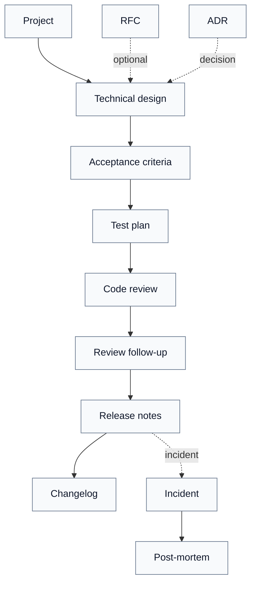

# Project to delivery

| Version | Date | Status | Owner | Template | Parent |
| --- | --- | --- | --- | --- | --- |
| 0.1.0 | 2026-10-28 | active | Markdown Guide | flows/project-to-delivery.md | [Flows](./README.md) |

## Abstract

A minimal delivery flow from project decisions to release, linking presets, templates, and explicit gates.

[↑ Back to top](#top) · [← Back](./README.md)

## Index

- [Abstract](#s-abstract)
- [Legend](#s-legend)
- [How to use](#s-how-to-use)
- [Flow](#s-flow)
- [Stages](#s-stages)
- [Gates](#s-gates)
- [Branches](#s-branches)
- [References](#s-references)
- [Constraints](#s-constraints)
- [Change history](#s-change-history)

[↑ Back to top](#top)

## Legend

| Prefix | Meaning | Scope |
| --- | --- | --- |
| ST | Stage | Stages |
| GT | Gate | Gates |
| BR | Branch | Branches |
| RF | Reference | References |
| V | Constraint | Constraints |

[↑ Back to top](#top) · [← Back](./README.md)

## How to use

- Copy this flow into the project documentation.
- Replace the links with the actual project documents.
- Use the preset and template for each stage.
- A stage is done when its gate is met.
- If a stage is skipped, record why in `## Constraints`.
- Keep the flow as an index: link details instead of duplicating them.

[↑ Back to top](#top) · [← Back](./README.md)

## Flow

Solid lines are the required path. Dotted lines are optional branches.

[↑ Back to top](#top) · [← Back](./README.md)

## Stages

| Stage | Preset | Template | Output | Gate |
| --- | --- | --- | --- | --- |
| **ST1** Project | [project](../skills/markdown-guide/presets/project.md) | [project.md](../skills/markdown-guide/templates/project.md) | Scope, decisions, open questions, tasks | [GT1](#gt1) |
| **ST2** Technical design | [technical-design](../skills/markdown-guide/presets/technical-design.md) | [technical-design.md](../skills/markdown-guide/templates/technical-design.md) | Architecture, components, interfaces, risks, rollout | [GT2](#gt2) |
| **ST3** Acceptance criteria | [acceptance-criteria](../skills/markdown-guide/presets/acceptance-criteria.md) | [acceptance-criteria.md](../skills/markdown-guide/templates/acceptance-criteria.md) | Testable Gherkin scenarios and traceability | [GT3](#gt3) |
| **ST4** Test plan | [test-plan](../skills/markdown-guide/presets/test-plan.md) | [test-plan.md](../skills/markdown-guide/templates/test-plan.md) | Strategy, environments, cases, entry/exit, results | [GT4](#gt4) |
| **ST5** Code review | [code-review](../skills/markdown-guide/presets/code-review.md) | [code-review.md](../skills/markdown-guide/templates/code-review.md) | Verdict, findings, tests, decisions, actions | [GT5](#gt5) |
| **ST6** Review follow-up | [review-followup](../skills/markdown-guide/presets/review-followup.md) | [review-followup.md](../skills/markdown-guide/templates/review-followup.md) | Triage, decisions, fixes, verification, closure | [GT6](#gt6) |
| **ST7** Release notes | [release-notes](../skills/markdown-guide/presets/release-notes.md) | [release-notes.md](../skills/markdown-guide/templates/release-notes.md) | Highlights, breaking changes, features, fixes, upgrades | [GT7](#gt7) |
| **ST8** Changelog | [changelog](../skills/markdown-guide/presets/changelog.md) | [changelog.md](../skills/markdown-guide/templates/changelog.md) | Versioned change log | [GT7](#gt7) |

[↑ Back to top](#top) · [← Back](./README.md)

## Gates

- **GT1 — Project ready.** No blocking open decisions; decisions and tasks have owners.
- **GT2 — Design ready.** Technical design links the RFC or ADR, and interfaces, risks, and rollout are explicit.
- **GT3 — Criteria ready.** Every acceptance criterion is testable and linked to a test case.
- **GT4 — Tests ready.** Exit criteria are met; failures and blockers have owners.
- **GT5 — Review ready.** The code review verdict is approve, or requested changes are closed.
- **GT6 — Follow-up ready.** Blocking review items are resolved and verified; deferred items have owner and date.
- **GT7 — Release ready.** Release notes and changelog are updated and consistent with the release version.

[↑ Back to top](#top) · [← Back](./README.md)

## Branches

- **BR1 — RFC.** Use before technical design when the approach is still open.
- **BR2 — ADR.** Use when a decision is made; link it from the project and technical design.
- **BR3 — Incident.** Use after release when an incident occurs; run incident, then post-mortem, and feed actions back to the project.

[↑ Back to top](#top) · [← Back](./README.md)

## References

- **RF1 — Preset registry.** [presets/index.md](../skills/markdown-guide/presets/index.md)
- **RF2 — Template directory.** [templates/](../skills/markdown-guide/templates/)
- **RF3 — Extension guide.** [references/extension.md](../skills/markdown-guide/references/extension.md)

[↑ Back to top](#top) · [← Back](./README.md)

## Constraints

No constraints.

[↑ Back to top](#top) · [← Back](./README.md)

## Change history

| Version | Date | Author | Change |
| --- | --- | --- | --- |
| 0.1.0 | 2026-10-28 | Markdown Guide | Initial version. |

[↑ Back to top](#top) · [← Back](./README.md)
